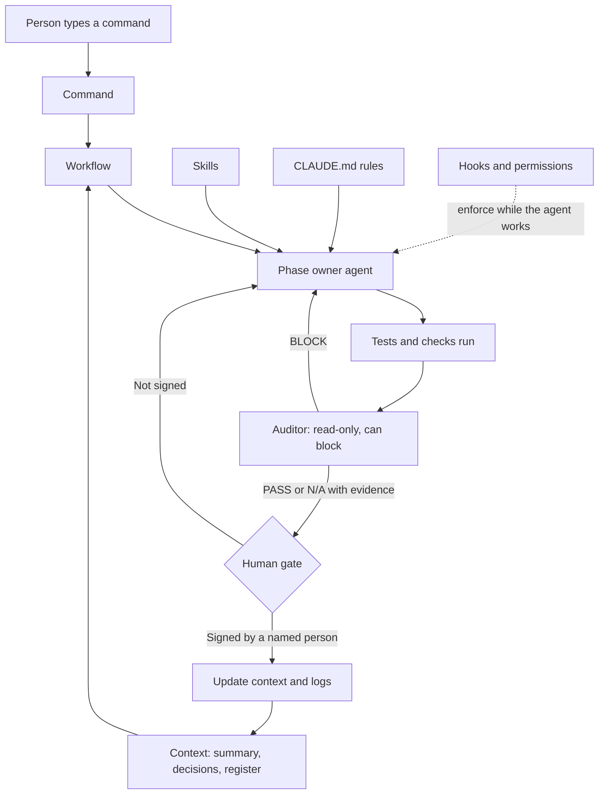

# audit-ready-blueprint

A method, an opinionated kit and a small working demonstration for setting up Claude Code to build software in an audited, regulated setting. Its argument is that the hard part of AI-assisted building there is being able to show that every decision traces to a rule and to a person. Getting the agent to produce code is the easy part.

## Who it is for

Product managers and engineering leads who must be able to answer an auditor's question about work an AI agent did, and reviewers who have to check that work later. You do not need to be a developer to read the method. You do need to be comfortable reading a short Python file to follow the demonstration.

## The idea in one diagram



[How the pieces connect](docs/how-the-pieces-connect.md) explains each step.

## What is different here

- **A reviewer that can block and cannot edit.** The auditor agent has no edit or write tool, so it cannot fix what it audits or alter the evidence through the file tools. It still has the shell, which tool settings cannot take away. That gap is stated in [kit/README.md](kit/README.md), and its successful calls are logged with its agent type. Only a fix or a recorded decision from the owner clears a block.
- **Checks that are run, with proof recorded by test id.** Every exit criterion names a test id or a command. An adjective is not proof.
- **Three honesty labels on every criterion.** Executed, read or not-verifiable, as defined in [docs/verification.md](docs/verification.md).
- **Rules enforced by permissions and hooks where possible, not only requested in prose.** `CLAUDE.md` is guidance that Claude Code does not enforce. The kit backs it with deny rules and hooks that fail closed.
- **The rulebook changes only with a person's approval, and a script detects drift.** Hooks block edits to the rulebook unless a person has created an approval file, and a permission rule and a hook both refuse the agent's writes to the folder that holds approvals. A check script catches the mechanical kinds of drift, such as counts written in prose, ids that nothing defines and links that go nowhere. See [docs/rulebook-drift.md](docs/rulebook-drift.md).
- **Every edge case gets a test before its fix, and every detection is shown able to fail.** Each guard is broken on purpose, once, and its test must go red. `python scripts/mutate_kit.py` repeats the proof.

## Three layers

| Layer | What it is | Domain |
|---|---|---|
| [templates/](templates/CLAUDE.md) | Generic blanks for any project, produced by the method in [BLUEPRINT.md](BLUEPRINT.md) | None |
| [kit/](kit/README.md) | An opinionated audit-safe setup, ready to copy into a project, with marked slots to fill | None |
| [example/](example/README.md) | The kit's slots filled in for one fictional project, specification side only | Supplier onboarding |

The working code is in [demo/](demo/README.md): an append-only ledger, fail-closed outbound messages and a rule that a model cannot override. [demo/WALKTHROUGH.md](demo/WALKTHROUGH.md) explains every line for someone new to Python.

## Quick start

1. **Copy the kit into a project.** `cp -R kit/. /path/to/your-project/`, then fill every slot. A slot is a piece of text that starts with two opening angle brackets and the word FILL. [kit/README.md](kit/README.md) lists them all and says how to search for them.
2. **Answer the questionnaire.** Copy [templates/questionnaire.md](templates/questionnaire.md), fill it in, and give it to Claude with [templates/generation-prompt.md](templates/generation-prompt.md). [example/questionnaire-answers.md](example/questionnaire-answers.md) is a worked answer.
3. **Run the tests.**

```bash
python3.12 -m venv .venv
.venv/bin/python -m pip install pytest
.venv/bin/python -m pytest
.venv/bin/python scripts/check_rulebook.py
```

## Verification status

Mirrored from [docs/verification.md](docs/verification.md), which has the full list.

| Claim | Label | Proof |
|---|---|---|
| The whole test suite passes | executed | `python -m pytest` exits 0. The recorded summary line is in [docs/verification.md](docs/verification.md). |
| The kit's file formats match the Claude Code documentation read on 2026-11-23 | read | [docs/conventions.md](docs/conventions.md) |
| The auditor has no edit or write tool | executed | `tests/test_kit_structure.py::test_invariant_auditor_has_no_edit_or_write_tool` |
| The auditor cannot change files through the shell | not-verifiable | It has the shell tool, and tool settings cannot remove that. Stated in [kit/README.md](kit/README.md). |
| A write to a protected file is blocked without an approved rule change, and allowed with one | executed | `tests/test_hooks.py::test_protected_path_blocked_without_approval`, `tests/test_hooks.py::test_protected_path_allowed_with_matching_approval_and_open_proposal` |
| The guards fail closed when their configuration is missing | executed | `tests/test_hooks.py::test_missing_guard_json_blocks_every_guard` |
| The hooks and deny rules work inside a live Claude Code session | executed, in print mode only | `python scripts/live_hook_test.py`. It also found that `onFailure` is ignored on the build machine's version, which the kit now covers. An interactive session was not tested. |
| An edited, deleted or reordered ledger entry is found, unless the file is rewritten from the edit onwards or its end is cut off, which a saved copy of the last hash catches | executed | `tests/test_ledger.py::test_editing_an_entry_is_detected`, `tests/test_ledger.py::test_deleting_an_entry_is_detected`, `tests/test_ledger.py::test_an_edit_that_recomputes_every_later_hash_is_not_detected_without_an_anchor` |
| An unsafe or missing outbound setting suppresses the message | executed | `tests/test_outbound.py::test_send_is_suppressed_when_mode_is_missing` |
| A failing rule can never end as verified, whatever a model proposes | executed | `tests/test_rules.py::test_a_failing_rule_can_never_end_as_verified_whatever_is_proposed` |
| Every detection can fail | executed | `python scripts/mutate_kit.py`, which ends with `mutations that stayed green or failed setup: 0` |
| The check script fails on a banned term, a prose count, a missing test id and a broken link | executed | `tests/test_check_rulebook.py::test_banned_term_fails`, `tests/test_check_rulebook.py::test_prose_count_of_invariants_fails`, `tests/test_check_rulebook.py::test_cited_test_id_that_does_not_exist_fails`, `tests/test_check_rulebook.py::test_broken_relative_link_fails` |
| Every register row the example marks covered cites a real test | executed | `tests/test_example.py::test_covered_register_rows_cite_real_tests_and_planned_rows_cite_none` |
| The example project has been built | not-verifiable | It has not. The example is a specification, and only [demo/](demo/README.md) runs. |

## What this is not

- **Not a security boundary.** Hooks and deny rules raise the cost of breaking a rule and leave evidence. A determined user with shell access can get around them.
- **Not a certified compliance product.** Nothing here has been assessed by an auditor or a regulator, and it claims no certification.
- **Not a production system.** The demonstration runs a few functions on synthetic data. It has no customers and makes no claim of production use.
- **The example domain is fictional.** Every company, person and record is invented, and no real service is called.

## The companion repository

A companion repository with the full build is planned. This section will link to it when it exists.

<!-- OWNER: add the link to the companion repository here when it exists, and then reword this section. -->

## Licence and author

MIT. See [LICENSE](LICENSE). Author: Taha Malik, [github.com/maliktaha9797](https://github.com/maliktaha9797).
