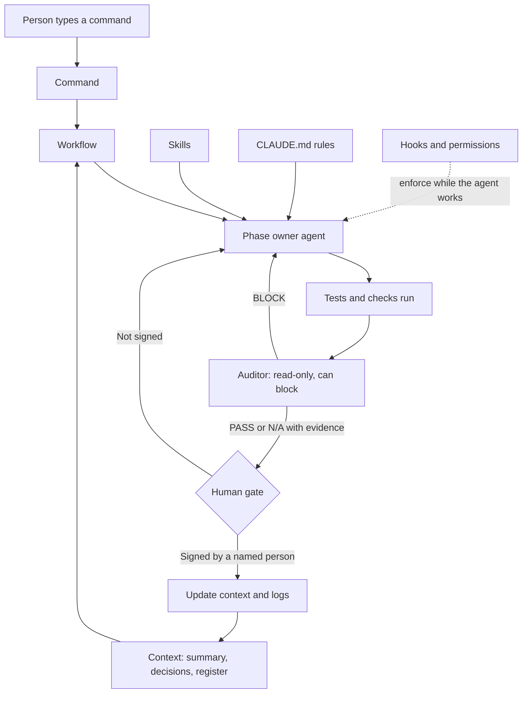

# How the pieces connect

A person starts a command. The command starts a workflow. The workflow reads the project context, gives the phase to an agent, and the agent reads the skills it needs and follows the rules in `CLAUDE.md`. A separate auditor checks the work. A person signs the gate. Only then is the context updated and the next phase started.

## Reading the diagram

| Step | What happens | Where it is written down |
|---|---|---|
| Command | A person types it. Claude cannot start it alone. | `.claude/skills/<command>/SKILL.md` with `disable-model-invocation: true` |
| Workflow | One description of the multi-phase process, shared by several commands. | `.claude/workflow-docs/<name>.md` |
| Context | The state the workflow reads first and updates last. | `.claude/context/` |
| Agent | The phase owner does the work in small slices. Each slice ends with a test. | `.claude/agents/<name>.md` |
| Skills and rules | Technical guidance the agent reads, and the rules it follows. | `.claude/skills/<name>/SKILL.md` and `CLAUDE.md` |
| Auditor | Runs the check for each invariant and returns a verdict. It has no edit or write tool, so it cannot fix what it audits through the file tools. It keeps the shell, which is a stated gap. A block is cleared by a fix or by a recorded decision from the owner. | `.claude/agents/invariant-auditor.md` |
| Human gate | A named person signs. The signature is recorded in the decision log and the phase log. | `.claude/context/decisions.md` and `.claude/context/phases/` |
| Hooks and permissions | Run while the agent works. They block writes to protected paths, and they record every successful tool call and every attempt that a guard blocks. | `.claude/settings.json`, `.claude/hooks/` |

## Where the loop can stop

- The auditor returns a BLOCK. The agent fixes the problem, or the owner records a decision that clears it. The agent cannot negotiate a block.
- The gate is not signed. The agent does not start the next phase.
- A hook blocks a write. The agent proposes a rule change and waits for a person.
